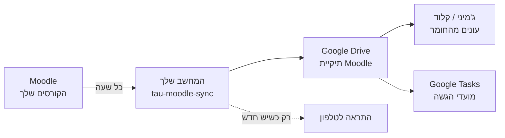

# tau-moodle-sync

> **In English:** a personal automation system that makes Tel Aviv University course material "AI-ready".
> Every hour it syncs all of a student's Moodle courses to Google Drive through Moodle's REST API, keeps the folder
> structure identical to the course pages, and writes an index that Claude / Gemini read first, so the AI can answer
> questions from the actual lectures and homework and cite the file. It also tracks new activities, updated files and
> grades, exports deadlines to Google Tasks, converts a course's public Notion site to Markdown + LaTeX, and can send a
> phone notification through a Claude routine fired over HTTP **only** when something new appears (event-driven, no polling).
>
> **Highlights:** passwordless token retrieval via the official mobile-app login flow, credentials encrypted with Windows
> DPAPI, incremental and resumable downloads (a failed file never aborts the run), silent first-sync for newly joined courses.
> Built with Windows PowerShell 5.1 and no dependencies, designed and developed together with Claude Code.
> The rest of this README is the (Hebrew) install guide for students.

כלי שמוריד אוטומטית, כל שעה, את כל הקבצים מהקורסים שלך במודל של אוניברסיטת תל אביב לתיקייה בגוגל דרייב. הקבצים מסודרים כמו באתר הקורס, כדי שג'מיני או קלוד יוכלו לענות לך על שאלות מהחומר.

כל אחד מוריד רק את החומר שלו, עם המפתח שלו, לדרייב שלו. אף קובץ קורס לא נמצא בריפו הזה.

## מה מקבלים

- **כל הקבצים מכל הקורסים, מעודכנים כל שעה:** הרצאות, תרגולים, תרגילי בית וקבצים שמצורפים למטלות, מסודרים לפי הסעיפים באתר הקורס.
- **ג'מיני או קלוד שעונים מהחומר של הקורס:** עם הסימונים של הקורס, ועם ציון הקובץ שממנו נלקחה התשובה.
- **בלי הגדרות:** הכלי מוצא לבד את הקורסים שאתם רשומים אליהם, וקורסים חדשים נוספים אוטומטית.
- **תוספות לבחירה:** מועדי הגשה ב-Google Tasks, והתראה לטלפון על מטלה חדשה, קובץ שעודכן או ציון חדש.

## מה צריך

- מחשב עם ווינדוס 10 או 11.
- התוכנה [גוגל דרייב למחשב](https://www.google.com/drive/download/), מחוברת לחשבון שאיתו ג'מיני או קלוד שלך עובדים.

## התקנה (5 דקות)

1. **הורדה:** נכנסים ל[גרסה האחרונה](https://github.com/gertelyoav/tau-moodle-sync/releases/latest) ומורידים את קובץ ה-ZIP שתחת `Assets` (`Source code (zip)`).
2. **שחרור החסימה:** לוחצים על קובץ ה-ZIP בכפתור הימני, נכנסים למאפיינים, מסמנים "בטל חסימה" ולוחצים אישור (`Properties → Unblock → OK`).
3. **פריסה:** פורסים את קובץ ה-ZIP לתיקייה קבועה, למשל בתוך "מסמכים". לא בתיקיית ההורדות, ולא בתוך הדרייב.
4. **הרצה:** לחיצה כפולה על הקובץ `setup.cmd`, וממלאים את מה שהוא שואל:
   - **המפתח למודל:** הדפדפן יפתח את המודל. מתחברים אם צריך, וכשהדפדפן שואל אם לפתוח את Windows PowerShell, מאשרים (`Open`). ככה הכלי מקבל את המפתח הקיים שלך, באותה דרך שבה אפליקציית Moodle מקבלת אותו. שום דבר לא מתאפס, והאפליקציה בטלפון ממשיכה לעבוד.
     - **לא ללחוץ "איפוס":** בדף "מפתחות אבטחה" במודל מופיעים רק שמות המפתחות, לא המפתחות עצמם, ואין צורך להיכנס אליו. לחיצה על "איפוס" שם תנתק את אפליקציית Moodle בטלפון ובטאבלט, ויהיה צורך להתחבר אליה מחדש.
   - **תיקיית הדרייב:** הסקריפט מוצא לבד את הדרייב. אם יש כמה חשבונות, בוחרים את החשבון שאיתו ג'מיני או קלוד עובדים.
   - **קורסים לדילוג:** מופיעה רשימת הקורסים שלך, ואפשר לבחור קורסים שלא צריך לסנכרן. מאגר הבחינות (אלפי קבצים) מסומן כהצעה, ו-Enter מקבל אותה.
   - **התראות לטלפון:** אופציונלי, אפשר לענות `n` ולהוסיף אחר כך (ראו בהמשך).
5. **סיום:** הסנכרון הראשון רץ מיד, ומעכשיו הוא ירוץ כל שעה עגולה בין 07:00 ל-23:00.

הכלי מוריד את כל הקורסים שאתם רשומים אליהם במודל, חוץ מאלה שבחרתם לדלג עליהם. מי שרשום לקורס מבוא לאופטימיזציה מקבל אוטומטית גם את אתר הנושן של הקורס.

הקבצים יופיעו בדרייב, ב"האחסון שלי", בתיקייה בשם Moodle.

## חיבור לבינה מלאכותית

אחרי ההתקנה צריך לחבר את ג'מיני או קלוד לתיקייה. מספיק לבחור אחד מהשניים.

### חיבור לג'מיני

1. נכנסים לאתר של ג'מיני ומתחברים עם החשבון שאליו הקבצים מסונכרנים (`gemini.google.com`).
2. בהגדרות, תחת האפליקציות המחוברות, מוודאים ש-Google Workspace מופעל (`Settings → Apps`).
3. בהגדרות פותחים את דף הסקילים ולוחצים על יצירה ידנית (`Settings → Skills → Create manually`).
4. ממלאים את שלושת השדות לפי הקובץ [skills/gemini/course-material.md](skills/gemini/course-material.md): שם, תיאור והוראות.
5. שומרים בכפתור היצירה שבראש הסקיל (`Create`).

### חיבור לקלוד

1. בהגדרות של קלוד מחברים את גוגל דרייב, עם החשבון שאליו הקבצים מסונכרנים (`Settings → Connectors → Google Drive`).
2. מורידים מהריפו את התיקייה `skills/claude/moodle-course-material`, ומכווצים אותה לקובץ ZIP.
3. בהגדרות של קלוד מעלים את קובץ ה-ZIP בדף הסקילים (`Settings → Capabilities → Skills`).

### בדיקה

שואלים שאלה על החומר, למשל: "מה נלמד בתרגול האחרון במבני נתונים?"
התשובה צריכה לציין מאיזה קובץ בתיקייה היא נלקחה.

## תוספת: מועדי הגשה ב-Google Tasks

הסנכרון שומר בתיקייה את הקובץ `deadlines.json`, עם כל המטלות והבחנים שיש להם מועד הגשה.
סקריפט קטן בחשבון הגוגל שלכם יכול להוסיף אותם אוטומטית, כל שעה, כמשימות ב-Google Tasks:

1. נכנסים לאתר של Apps Script, עם החשבון שהקבצים בדרייב שלו, ויוצרים פרויקט חדש (`script.google.com → New project`).
2. מוחקים את הקוד שמופיע, ומדביקים במקומו את התוכן של הקובץ [google-tasks/Code.gs](google-tasks/Code.gs).
3. בתפריט שמשמאל מוסיפים את השירות של Google Tasks (`Services → + → Google Tasks API`).
4. בוחרים את הפונקציה `setup` ולוחצים הפעלה (`Run`), ומאשרים את ההרשאות. גוגל יזהיר שהאפליקציה לא מאומתת, כי זה סקריפט שלכם (`Advanced → Go to project`).

## תוספת: התראות לטלפון על דברים חדשים

אפשר לקבל התראה לטלפון (באפליקציה של קלוד) רק כשהסנכרון מוצא משהו חדש: פריט חדש בקורס, קובץ שעודכן או ציון חדש. כשאין חדש, לא נשלח כלום.

צריך מנוי לקלוד שכולל רוטינות.

1. יוצרים רוטינה לפי ההוראות בקובץ [skills/claude/notify-routine.md](skills/claude/notify-routine.md). יש שם טקסט מוכן להדבקה.
2. מריצים את `save-claude-token.cmd` (או עונים `y` בשלב 4 של `setup.cmd`), ומדביקים את מזהה הרוטינה ואת המפתח שלה. המפתח נשמר מוצפן, כמו המפתח למודל.

## דילוג על קורסים

כדי לשנות את הקורסים שמדלגים עליהם, מריצים שוב את `setup.cmd`, עונים `n` להחלפת המפתח, ובוחרים מחדש בשלב 3.
(מאחורי הקלעים הרשימה נשמרת ב-`config.json`, בשדה `moodleSkipCourses`.)

## עדכון לגרסה חדשה

1. מורידים את קובץ ה-ZIP של [הגרסה האחרונה](https://github.com/gertelyoav/tau-moodle-sync/releases/latest), ומשחררים את החסימה שלו כמו בהתקנה.
2. פורסים אותו, ומעתיקים את כל הקבצים שבתוכו לתיקייה הקיימת של הכלי. כשווינדוס שואל, בוחרים להחליף את הקבצים.
3. זהו. המפתח השמור (`token.dat`), ההגדרות (`config.json`) והקבצים בדרייב לא נמצאים ב-ZIP, ולכן הם נשארים כמו שהם. אם בהערות של הגרסה כתוב להריץ שוב את `setup.cmd`, מריצים ועונים `n` להחלפת המפתח.

כדי לדעת על גרסאות חדשות: בראש הדף בגיטהאב לוחצים `Watch → Custom → Releases`.

## אבטחה

- המפתח שלך למודל נשמר מוצפן בקובץ `token.dat`, בהצפנה של Windows (DPAPI): רק המשתמש שלך במחשב הזה יכול לפענח אותו.
- המפתח לא נשמר כטקסט רגיל, ונשלח רק לאתר המודל.
- הקבצים האישיים חסומים מהעלאה לגיטהאב בקובץ `.gitignore`: `config.json`, `token.dat`, `claude-routine-token.dat`, `log.txt`.
- הקוד קצר וגלוי: `moodle-sync.ps1` פונה רק לאתר המודל, ו-`notion-sync.ps1` פונה רק לאתר הנושן הציבורי של הקורס.
- להסרה מריצים את `uninstall.cmd`: הוא מוחק את הסנכרון ואת המפתח השמור.
- לביטול מלא של המפתח: בדף "מפתחות אבטחה" במודל לוחצים "איפוס" בשורה של שירות האפליקציה (`Moodle mobile web service`). שימו לב: אחרי האיפוס צריך להתחבר מחדש לאפליקציית Moodle בטלפון ובטאבלט.
- כדי לקבל את המפתח, ההתקנה רושמת לרגע את הכלי כמי שפותח קישורים של אפליקציית Moodle (רק למשתמש שלך), ומבטלת את הרישום מיד אחרי זה.

## הצהרה ואחריות

- זהו כלי לא רשמי. הוא אינו קשור לאוניברסיטת תל אביב, ל-Virtual TAU, ל-Google או ל-Anthropic, ואינו מאושר על ידם.
- הכלי לא מפיץ חומרי קורס. כל משתמש מוריד רק את החומרים שכבר יש לו גישה אליהם, עם המפתח האישי שלו, למחשב ולדרייב שלו.
- חומרי הקורסים מוגנים בזכויות יוצרים של המרצים והאוניברסיטה. הם לשימוש אישי ולימודי בלבד: אין לשתף את התיקייה, להעלות אותה למקום ציבורי או להפיץ ממנה קבצים.
- האחריות לעמוד בתקנון האוניברסיטה, בכללי השימוש במערכות המחשוב שלה ובהנחיות של כל קורס היא של המשתמש. זה כולל הנחיות של מרצים לגבי העלאת חומרי קורס לכלי בינה מלאכותית.
- הכלי מסופק כמו שהוא, בלי שום אחריות (ראו `LICENSE`). השימוש בו על אחריותך בלבד.
- מחבר הכלי לא אוסף שום מידע: אין שרת, והכול רץ במחשב שלך.

## שימוש שוטף
- **סנכרון מיידי:** `sync-now.cmd`.
- **מה קרה בסנכרון:** `log.txt`.
- **כמה מחשבים:** מתקינים את הכלי במחשב אחד בלבד לכל חשבון מודל. שני מחשבים שמסנכרנים לאותה תיקייה יתנגשו זה בזה.
- **המפתח הפסיק לעבוד** (בלוג מופיעה שגיאה על מפתח לא תקין): מריצים שוב את `setup.cmd`, עונים `y` להחלפת המפתח, ומאשרים בדפדפן כמו בהתקנה.

## פתרון בעיות

- **הדפדפן לא שאל אם לפתוח את PowerShell:** בודקים שאתם מחוברים למודל באותו דפדפן, ומריצים שוב את `setup.cmd`. אם הדפדפן חוסם את הבקשה, מאשרים אותה בסרגל הכתובות.
- **מופיעה אזהרה כחולה של Windows ("Windows protected your PC"):** לא בוצע שחרור החסימה של קובץ ה-ZIP (שלב 2 בהתקנה). מוחקים את התיקייה, משחררים את החסימה ופורסים מחדש.
- **משהו אחר:** הפרטים נמצאים בקובץ `log.txt` שבתיקיית הכלי. אם לא מסתדרים, [פותחים דיווח על תקלה](https://github.com/gertelyoav/tau-moodle-sync/issues/new/choose) ומצרפים את השורות הרלוונטיות מהלוג (בלי המפתח ובלי `token.dat`).

## קבצים
| קובץ | מה הוא עושה |
|---|---|
| `setup.cmd` / `setup.ps1` | התקנה: שמירת המפתח, בחירת תיקייה, יצירת משימה שעתית |
| `moodle-sync.ps1` | הסנכרון מהמודל (כולל מעקב אחרי פריטים וציונים חדשים ב-`updates.json`) |
| `common.ps1` | פונקציות משותפות להתקנה, לסנכרון ולבדיקות |
| `notion-sync.ps1` | העתקת אתר קורס ציבורי בנושן לקבצי Markdown |
| `sync-now.cmd` | הרצה ידנית |
| `uninstall.cmd` | הסרה |
| `save-claude-token.cmd` | שמירת מזהה רוטינת ההתראות והמפתח שלה (מוצפן), אופציונלי |
| `skills/` | סקילים מוכנים לג'מיני ולקלוד, וההוראות לרוטינת ההתראות |
| `tests/run-tests.ps1` | בדיקות שלא צריכות חשבון מודל. רצות אוטומטית בגיטהאב על כל שינוי |
| `google-tasks/Code.gs` | סקריפט שמוסיף את מועדי ההגשה ל-Google Tasks |
